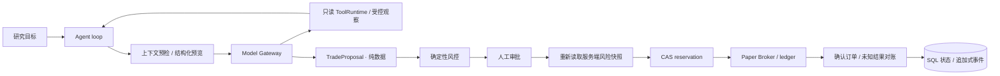

# AI Trader · 可恢复的研究 Agent 与 Paper 执行系统

[](https://github.com/happiness-cheng/ai-trader/actions/workflows/ci.yml)

**让模型分析证据、生成提案；让服务端风控与人工审批决定执行。** 项目以 Paper 交易为场景，处理 Agent 输入增长、工具调用、重复审批、响应丢失和状态恢复等工程问题。

**Python / Pydantic / FastAPI / SQLAlchemy / SQLite / MCP / Anthropic-compatible provider**

[快速运行](#快速运行无需-api-key) · [故障与实验记录](docs/project-evidence.md) · [HTTP 服务](docs/2026-10-14-production-guards.md) · [RAG 配套项目](https://github.com/happiness-cheng/knowledge-base)

## 项目看点

| 具体问题 | 方案与取舍 | 可查证结果 |
|---|---|---|
| LLM 的 BUY 文本不等于可执行订单 | 只读工具 → 类型化提案 → 服务端风险重检 → 人工审批 → Paper 执行 | 成交、拒绝、重复批准、重启恢复都有实际链路测试 |
| broker 已落盘，调用方没收到响应 | CAS 执行占位；保留 unknown，先只读对账，避免直接重发 | 响应丢失后重启，对账与再次批准仍为 **1 单** |
| 工具观察太大，下一次模型请求超限 | 完整请求预检；比较整轮删除与结构化预览，保留工具配对和风险原字段 | 2500 字符预算样本：**17567 → 1267 字符**；放不下则在 provider 前拒发 |
| SQL 订单正常，Paper ledger 已丢失 | readiness / 写入 / 备份恢复共用业务一致性规则 | 缺账重启后 **ready 503 / 写入 503**；合法未知成交仍可恢复 |
| timeout 返回了，handler 还在运行 | 全进程 4 槽；任务实际结束才归还容量 | 8 次探测最多 **4 个在途**，4 timeout + 4 容量拒绝 |

当前本地验证（2026-10-15）：**228 项通过，覆盖率 87.43%**（门槛 85%）；**51 个模块 mypy 通过**，wheel 源码一致性与隔离演示验证通过。[命令和证据 →](docs/project-evidence.md#验证与复现)

## 一条完整业务链



模型只能提出建议，不能通过工具调用下单。审批前重新读取现金、持仓与行情；模型输出、工具观察和历史记忆都不能覆盖这些服务端事实。

当前可启动的 Paper 入口只给模型一个 `get_quote`，模型与行情默认使用离线 fixture。旧行情工具、根目录交易应用与训练实验保留为历史代码，不与这条已验证的 runtime 主线混用。

## 关键设计与 trade-off

### 1. 把“未知”当作业务状态

外部副作用可能已经发生，HTTP 异常不能证明“没有成交”。执行前保留 proposal 身份与 reservation；异常后对账找到同一订单才推进成功，没找到继续保留未知。取舍是暂时少一些可用性，避免不确定结果被直接重试。

20 个不同待审批 run / 8 客户端的并发样本中，执行前仓位复核得到 **1 次 200、19 次风控 409、1 单**。这说明该边界下的风控保护，不是 20 个成功任务吞吐，也不宣称分布式 exactly-once。

### 2. 控制下一次请求，而不只累计 usage

`ContextBuilder` 检查完整 `ModelRequest`，保留工具调用/结果配对、最新观察、受保护风险原字段与服务器约束。结构化预览有不完整标记、原长度和审计 hash；它不是 LLM 总结，也不把观察升级成可信 system 事实。

旧大历史样本可用整轮裁剪；最新观察本身超限时，整轮裁剪无效，结构化预览仍可进入预算。当前单位是**序列化字符**，未接匹配 tokenizer 时不称为硬 token 预算或真实模型质量提升。

### 3. 记忆与 MCP 复用服务端边界

- 记忆只接收可信入口提供的已确认业务事件，带 owner、来源、确认时间、TTL 与冲突语义；旧建议始终是历史上下文。Paper 记忆 sink 显式注入、默认关闭，写失败不触发再次交易。
- MCP 使用官方 SDK 的 stdio 接口，复用 `ToolRuntime` 校验；只读 allowlist 不仅过滤列表，也拒绝直接调用写工具。`readOnlyHint` 是提示，不是权限。
- 按任务说明、手工 schema 选择是可运行候选；Paper 没有默认启用自动工具发现，不把 fixture 的字符收益写成模型决策收益。

## 快速运行：无需 API Key

Windows / Python 3.12，依赖安装后即可运行离线演示：

```powershell
git clone https://github.com/happiness-cheng/ai-trader.git
cd ai-trader
py -3.12 -m venv .venv
.venv/Scripts/python.exe -m pip install -e ".[test,mcp,memory]" -c constraints.verified-win-py312.txt

# 分析 → 等待审批 → Paper 成交 → 重复审批返回同单
.venv/Scripts/python.exe -X utf8 -m ai_trader.paper_demo

# broker 写成后注入响应丢失 → 重建仓库 → 对账恢复
.venv/Scripts/python.exe -X utf8 -m ai_trader.paper_demo --response-loss

# 隔离个人配置与状态，阻断进程内外网
.venv/Scripts/python.exe -X utf8 -m ai_trader.offline_tests --verify-isolation
.venv/Scripts/python.exe -X utf8 -m ai_trader.offline_tests -W error::ResourceWarning --cov=ai_trader --cov-fail-under=85 -q
```

两条 Paper 演示预期：`state=succeeded`、`orders=1`、`duplicate_same_order=true`；丢响应演示另有 `recovered=true`。状态写入新的临时目录；指定 `--output` 时必须给尚不存在的目录。

### 本机 HTTP 与 MCP

```powershell
# 只监听 loopback，状态目录必须绝对路径；首次运行选新目录
.venv/Scripts/python.exe -X utf8 -m ai_trader.paper_service --state-directory "$env:TEMP/ai-trader-paper-demo" --port 8000

# 独立 stdio 服务，只暴露 fixture get_quote
.venv/Scripts/python.exe -X utf8 -m ai_trader.tools.readonly_mcp --fixture
```

HTTP 的 create / analyze / approve / reject / reconcile 调用见[服务说明](docs/2026-10-13-paper-service.md)。`--production --operator-token-file <已有文件>`启用显式 Bearer 保护，仍是可信本机单用户边界；`X-Reviewer-Id` 只做审计标签。`/health` 表示进程存活，`/ready` 检查 SQL / ledger 一致性。

## 代码阅读路线

| 能力 | 入口 |
|---|---|
| 模型与工具循环 | [runner.py](src/ai_trader/agents/runner.py) / [gateway.py](src/ai_trader/models/gateway.py) |
| 上下文三策略 | [context.py](src/ai_trader/agents/context.py) / [对照测试](tests/unit/test_context_builder.py) |
| 提案到执行、未知结果对账 | [workflow.py](src/ai_trader/execution/workflow.py) / [coordinator.py](src/ai_trader/execution/coordinator.py) |
| 已确认记忆 / 冲突与生命周期 | [lifecycle.py](src/ai_trader/memory/lifecycle.py) / [业务事件测试](tests/integration/test_paper_memory_event.py) |
| 只读 MCP / 有界工具容量 | [readonly_mcp.py](src/ai_trader/tools/readonly_mcp.py) / [runtime.py](src/ai_trader/tools/runtime.py) |
| 状态一致性与备份恢复 | [state_health.py](src/ai_trader/state_health.py) / [state_backup.py](src/ai_trader/state_backup.py) |
| 可启动入口与 wheel 检查 | [paper_service.py](src/ai_trader/paper_service.py) / [check_wheel.py](scripts/check_wheel.py) |

## 验证范围

验证覆盖真实代码循环、SQL/Paper 副作用、本机 HTTP、stdio、重启与故障恢复；模型/行情主要是 fixture，不证明真实 LLM 交易质量或收益。单目录单进程、串行写请求、全量账本核验适合当前本地验证，不提供跨主机 exactly-once、部分成交/结算、多账户资金预占或线上 SLA。

wheel 只交付 `src/ai_trader` runtime，不包含根目录旧交易应用、模型权重、个人凭据或业务状态。历史设计记录保留原时间点，当前范围以此 README 和[证据页](docs/project-evidence.md)为准。

本项目用于 Agent 工程实践与模拟交易，不构成投资建议。
